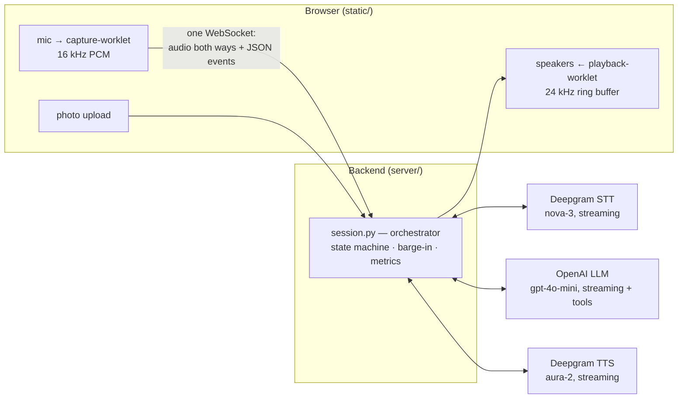
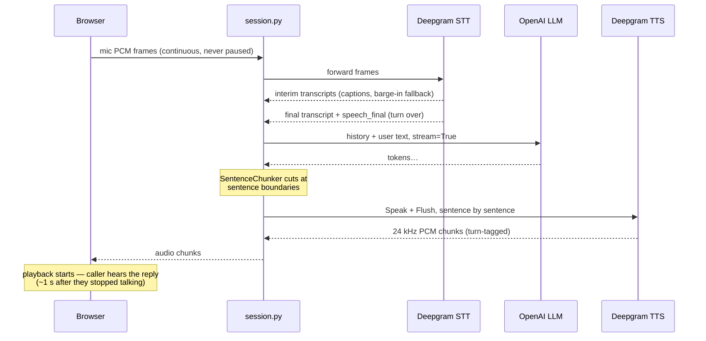

# How it all links together

[Doc 01](01-how-this-app-works.md) walks one utterance through the pipeline in prose;
this doc is the same system drawn as diagrams. Two diagrams: the static map of who
talks to whom, then one voice turn as a timeline.

One rule governs every box below, and it's worth stating before the pictures:
**nothing may regress voice-to-voice latency** (the hard rule running through
[doc 03](03-production-challenges.md)). Everything on the path from your voice to the
agent's voice streams; everything else — context summarization, for example — happens
at or after the turn boundary, once the caller has already heard the reply.

## The system map

Reading the map:

- **One WebSocket** carries everything between browser and backend: binary mic audio
  up, binary TTS audio down, JSON events both ways. Each connection gets its own
  `Session` — the orchestrator that owns the other three connections (STT socket, TTS
  socket, in-flight LLM stream) and all conversation state.
- **Solid arrows are the hot path.** All three provider links stream: STT transcribes
  while you're still talking, the LLM streams tokens, TTS synthesizes sentence one
  while the model writes sentence three.

## One voice turn, as a timeline

Reading the timeline:

- **It's pure overlap.** No stage waits for the previous one to finish;
  that's why voice-to-voice lands around a second instead of five (doc 01 does the
  arithmetic).
- **Not drawn, same spirit:** barge-in (the caller talking over the agent cancels the
  LLM stream, clears TTS, and zeroes the browser's ring buffer — doc 01 §barge-in),
  and canned speech (greeting, image filler, idle nudge), which bypasses the LLM
  entirely.

Where to go next: `server/session.py`'s docstring for the wire protocol the diagrams
abbreviate.
