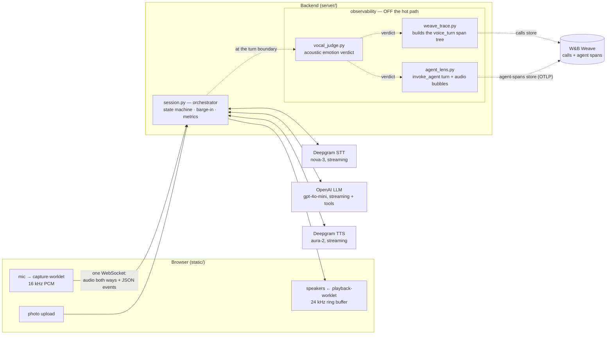
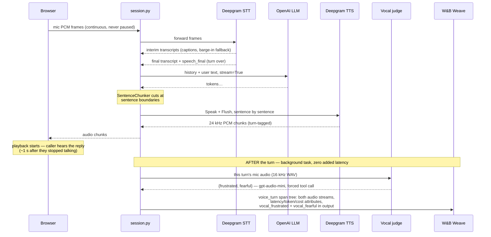

# How it all links together

[Doc 01](01-how-this-app-works.md) walks one utterance through the pipeline in prose;
this doc is the same system drawn as diagrams, with the observability layer — which
doc 01 predates — in the picture. Two diagrams: the static map of who talks to whom,
then one voice turn as a timeline.

One rule governs every box below, and it's worth stating before the pictures:
**nothing may regress voice-to-voice latency** (the hard rule running through
[doc 03](03-production-challenges.md)). Everything on the path from your voice to the
agent's voice streams; everything else — tracing, the vocal judge, context
summarization — happens at or after the turn boundary, once the caller has already
heard the reply.

## The system map

Reading the map:

- **One WebSocket** carries everything between browser and backend: binary mic audio
  up, binary TTS audio down, JSON events both ways. Each connection gets its own
  `Session` — the orchestrator that owns the other three connections (STT socket, TTS
  socket, in-flight LLM stream) and all conversation state.
- **Solid arrows are the hot path.** All three provider links stream: STT transcribes
  while you're still talking, the LLM streams tokens, TTS synthesizes sentence one
  while the model writes sentence three.
- **Dotted arrows are the side-channel.** One post-turn background task
  (`session.py::_judge_and_trace`) fans out: vocal judge → Weave `voice_turn` trace →
  Agent Lens turn (`agent_lens.py`), the last two landing in two *independent* stores
  (call traces vs agent spans) correlated by `session_id`. Unplug them (no
  `WANDB_API_KEY`) and the solid arrows don't change at all. Field-level detail:
  [doc 07](07-trace-shaping.md).

## One voice turn, as a timeline

Reading the timeline:

- **The first half is pure overlap.** No stage waits for the previous one to finish;
  that's why voice-to-voice lands around a second instead of five (doc 01 does the
  arithmetic).
- **The turn boundary is where the deferred work goes.** A turn is spread across
  asyncio tasks, so rather than wrap live spans around it, `session.py` *collects* the
  turn's data as it happens and hands the finished bundle to `weave_trace.py` once the
  reply has been heard. The vocal judge runs first (one audio-model call on the
  caller's mic clip, bounded by a timeout), then the whole `voice_turn` tree is
  emitted with the verdict folded into its output. Judge fails or times out? The
  trace ships anyway, with `null` flags.
- **Not drawn, same spirit:** barge-in (the caller talking over the agent cancels the
  LLM stream, clears TTS, and zeroes the browser's ring buffer — doc 01 §barge-in),
  and canned speech (greeting, image filler, idle nudge), which bypasses the LLM
  entirely and is traced as `system_utterance`, not `voice_turn`.

Where to go next: [doc 06](06-weights-and-biases.md) for what the traces look like in
W&B and the lessons learned wiring it; `server/session.py`'s docstring for the wire
protocol the diagrams abbreviate.
