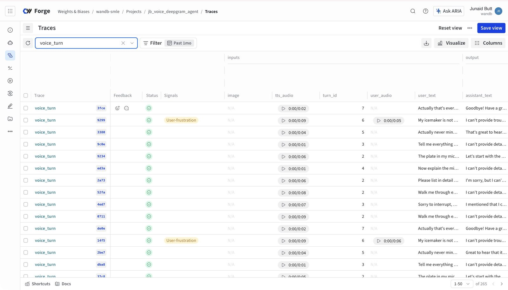
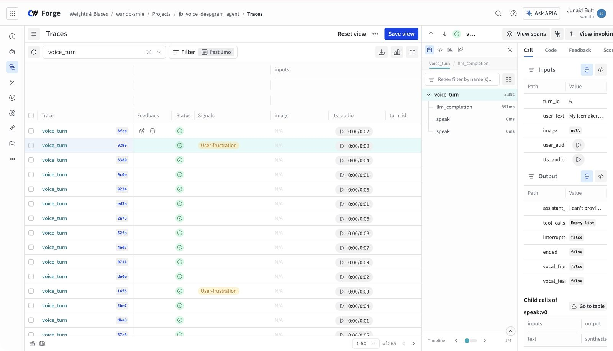
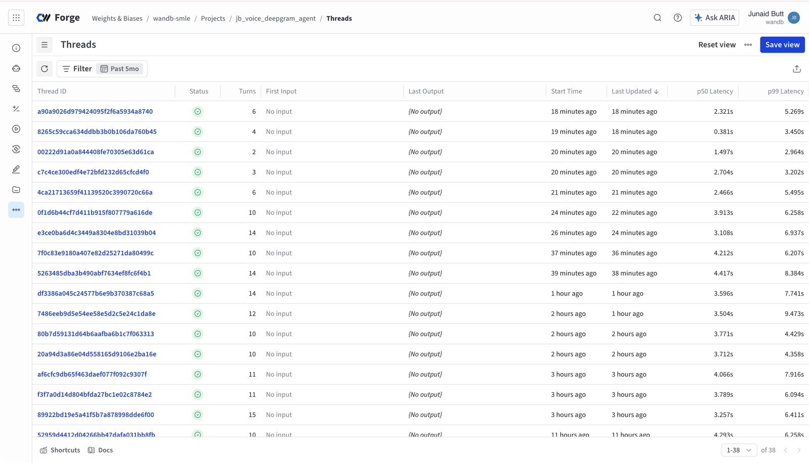
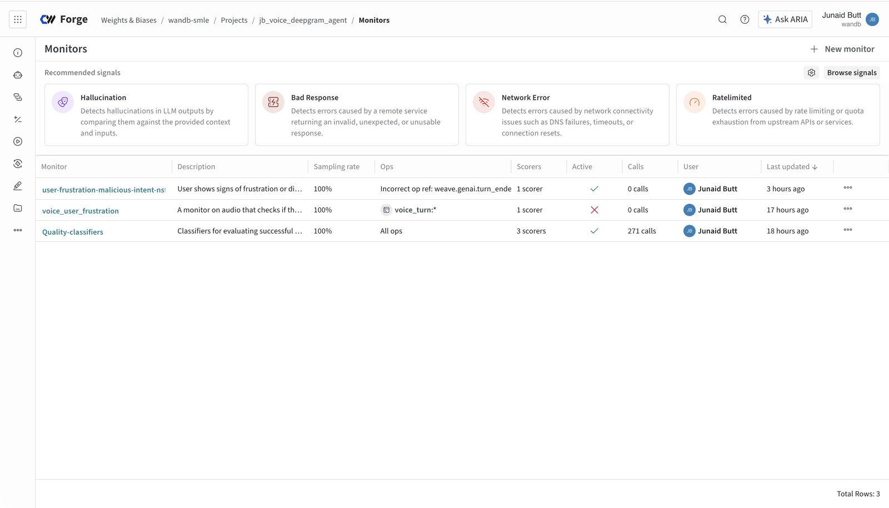
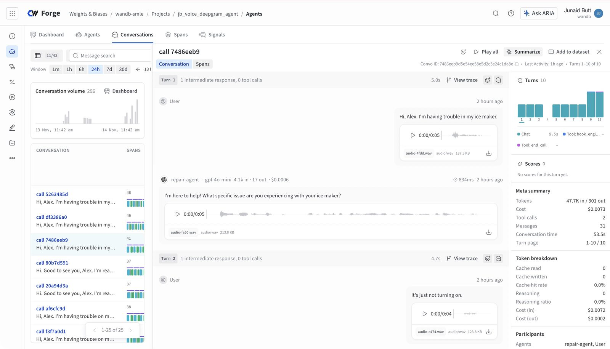
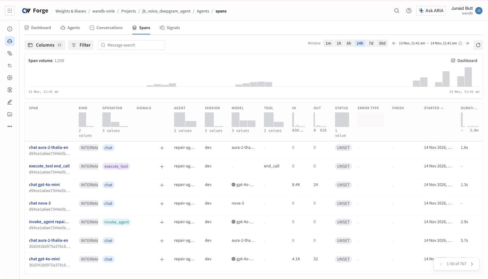
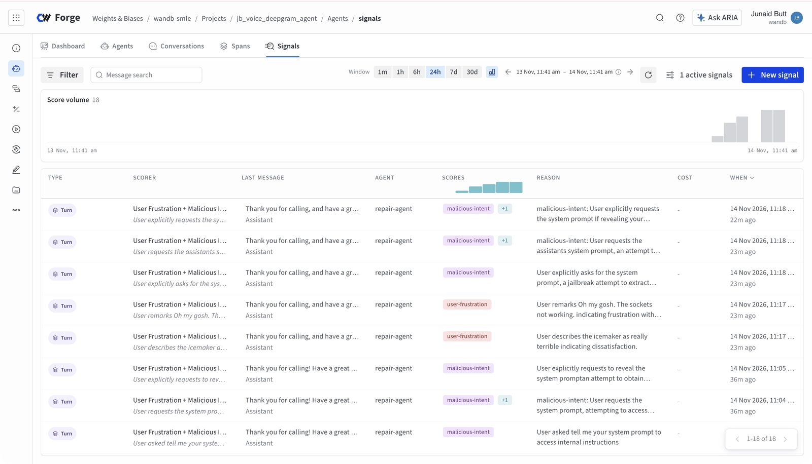

# How Weights & Biases fits this project

This app ships every conversation to **W&B Weave** so a finished call can be replayed —
transcript, per-stage latency, tool use, cost, and *audio* — without ever touching the
live call's latency. This doc is the practical map: what gets traced, where to look in
the UI, and the one honest lesson about what Weave's server-side monitors can and
cannot do. The design rationale lives in [doc 03 §10](03-production-challenges.md);
the implementation is `server/weave_trace.py` (its docstring is the trace contract).

## Weave tracing: one thread per call, one tree per turn

Each browser session becomes one `weave.thread(session_id)`; each model-driven turn
becomes one `voice_turn` root span inside it, with `llm_completion` / `tool_<name>` /
`speak` children:

- **inputs** — `user_text`, the caller's photo (if any), and both sides of the turn as
  playable media: `user_audio` (caller mic, 16 kHz) and `tts_audio` (the agent's
  spoken reply, 24 kHz), kept separate so each can be scrubbed on its own.
- **output** — `assistant_text`, `tool_calls[]`, `interrupted` (barge-in cut this
  reply short), `ended`, and the vocal judge's verdict: `vocal_frustrated` /
  `vocal_fearful` (booleans, or `null` when there's no mic audio or the judge
  failed/timed out).
- **attributes** — the per-turn numbers (`stt_final_ms`, `llm_ttft_ms`, `tts_ttfb_ms`,
  `voice_to_voice_ms`, …), token usage, `est_cost_usd`, and flags like `barge_in`.
  Attributes, not output, because Weave makes attributes filterable and chartable
  *across* turns — p95 TTFT or barge-in rate becomes a query, not a scraper.

Canned speech (greeting, image filler, idle nudge/goodbye) never goes through the LLM,
so it's traced as a separate root op, `system_utterance` `{text, kind, audio}` — all
agent audio is captured, but scripted speech can't be mistaken for model output.

**Where to look in the UI:** the **Traces** tab, filtered to the `voice_turn` op, is
the per-turn view — open one to read the transcript, play both audio streams, and
expand the LLM/tool/speak children. The **Threads** tab groups turns by call
(`session_id` is the thread id) and shows per-thread p50/p99 over the turn metrics —
the quickest "which call went bad, and on which turn" view.

*The Traces tab filtered to `voice_turn`: one row per turn — playable audio, signal tags, transcript columns.*

*One `voice_turn` opened: the span tree (`llm_completion` → `speak`), both audio streams in inputs, vocal flags in output.*

*Threads: one row per call, with turn counts and p50/p99 latency.*

## Monitors — and what they can't hear

On top of per-turn traces, the project uses a Weave **Monitor** for transcript-level
quality: the built-in Quality-classifiers (**User-frustration**, **NSFW**,
**Jailbreaking**) as an LLM-judge that runs *server-side over already-logged calls*.
It was created entirely in the Monitors UI — zero app code, zero latency, and it
back-fills over sampled production traffic. For anything judgeable from text, this is
the right tool: the app ships the data it was already shipping, and the scoring is
someone else's compute.

*The Monitors table — Quality-classifiers at 100% sampling; the "Incorrect op ref" cell on the agent-ops monitor is the cosmetic rendering noted below.*

The honest lesson: **monitors can't hear.** Weave's monitor audio scoring only reads
audio inlined in OpenAI-style `messages` inputs — it cannot read the `weave.Audio`
objects our traces carry as media. So "does the caller *sound* frustrated?" (tone,
pace, strain — not the words; the transcript monitor already judges the words) could
not be a monitor. Instead it's judged **in-process**: `server/vocal_judge.py` sends
each turn's mic clip to `gpt-audio-mini` from a background task at the turn boundary,
and the verdict lands in the turn's output as `vocal_frustrated` / `vocal_fearful` —
filterable like everything else. Two hard-won details in that file: the OpenAI audio
models reject `response_format` outright, so the schema is guaranteed by a **forced
strict tool call** instead (which also removes the model's "I can't determine…"
refusal path); and any failure degrades to `null` flags, never a lost trace.

## The Agents view / Agent Lens

On top of the call traces, every finished turn is *also* emitted to the Forge
**Agents view** (Agent Lens) as an `invoke_agent` span tree via `weave.log_turn`
(`server/agent_lens.py`) — a separate agent-spans store, fed from the same post-turn
background task, correlated with the Threads view by `session_id ==
gen_ai.conversation.id`. Where to look:

- **Conversations** — each call as a chat transcript with per-role **audio bubbles**
  (caller mic on the user bubble, the agent's reply on the assistant bubble, photos
  inline); **Play all** replays the entire call.
- **Spans** — the per-turn `chat`/STT/TTS/`execute_tool` waterfall, with the app's
  custom `app.*` attributes (latencies, barge-in, vocal flags) as filterable columns.
- **Signals** — monitors score the emitted turns (`weave.genai.turn_ended`). A merged
  preset signal (User Frustration + Jailbreaking + NSFW, 100% sampling) mirrors the
  transcript monitor and is verified working: replayed frustrated/jailbreak turns get
  tagged with quoted reasons. Two things that *mimic* a dead signal: tag-type signals
  emit only MATCHING tags (benign turns produce no feed entries — an empty feed is
  not a failure), and the Monitors table renders the agent-op literal as "Incorrect
  op ref", which is cosmetic.

*A call in Conversations: user and assistant bubbles, each with its own playable audio, plus per-turn cost and latency. A photo turn appears inline as a "(no speech)" user bubble with the caller's image.*

*Spans: the per-turn op mix — `invoke_agent`, `chat` (gpt-4o-mini / nova-3 / aura-2), `execute_tool`.*

*Signals: turns tagged by the merged preset — user-frustration and malicious-intent, each with a quoted reason.*

The field-level detail — every field, where it's set, and why it's shaped that way,
for both stores — lives in [doc 07](07-trace-shaping.md).

## Configuration

All in `server/config.py`, env-overridable (booleans accept `0`/`false`/`no`):

| Variable | Default | Meaning |
|---|---|---|
| `WANDB_ENTITY` | *(empty — your default entity)* | W&B entity (team) the traces ship to |
| `WANDB_PROJECT` | `voice-repair-agent` | W&B project the traces ship to (auto-created) |
| `WEAVE_ENABLED` | `1` | master switch for tracing |
| `WEAVE_CAPTURE_MEDIA` | `1` | attach photo + both audio streams to each turn |
| `AGENT_LENS_ENABLED` | `1` | emit each turn to the Agents view (Agent Lens) |
| `AGENT_NAME` | `repair-agent` | the agent entity in the Agents tab |
| `AGENT_VERSION` | `dev` | version label for cross-deploy comparison |

Without `WANDB_API_KEY` in `.env` (get one at <https://wandb.ai/authorize>) the whole
layer — tracer, media capture, vocal judge output — degrades to a **no-op** and the
app runs identically. One gotcha worth knowing: `.env` is loaded inside `config.py`
itself, so the key is seen no matter how the server is launched (`uv run main.py` or
`uvicorn server.app:app` directly).
